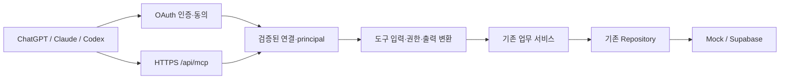

# 원격 운영 MCP 구현 설계

[명세](./spec.md) / [#602](https://github.com/MyKnow/ssartnership/issues/602)

## 경계와 재사용

Next.js Node runtime의 `/api/mcp`에 공식 TypeScript SDK Streamable HTTP를 붙인다. 도구 인자 검증과 안전한 업무 결과는 `src/lib/mcp/read-service.ts`에 둔다. Next 쿠키·redirect guard를 도구에서 호출하지 않는다. 검증된 transport가 principal을 주입하고 현재 계정을 읽는 adapter와 기존 repository를 연결한다. 현재 `getAdminAccountById`는 cache를 사용하므로 새 연결 경계에는 기존 uncached 구현을 명시적으로 재사용해야 한다.

공식 v2 stable `@modelcontextprotocol/server`와 검증용 client를 정확 버전 `2.3.1`로 고정하고 package/lock을 함께 변경했다. `createMcpHandler`가 매 요청 서버를 생성하며 legacy stateless와 modern auto JSON 응답을 지원한다. subscription 상한은 0이고 요청 본문 상한은 16KiB다. 인증이 검증된 뒤에만 도구를 등록한다.

## 인증과 연결

외부 서비스 token 공유 없이 싸트너십 앱의 로그인과 관리자 계정을 사용하는 앱 내 OAuth 제공자를 둔다. 검증된 OAuth/공식 SDK adapter를 우선 사용하고 provider interface를 통해 기존 로그인과 연결한다. 제공자가 SDK만으로 충족되지 않는 표준은 별도 보안 검토와 회귀 테스트 후 제공한다.

- 제안 canonical resource: 환경별 고정 HTTPS origin + `/api/mcp`. issuer와 resource는 서버 설정 allowlist에서만 결정하며 Host 헤더/도구 입력으로 만들지 않는다. Preview/Production 토큰과 저장소는 분리한다.
- Protected Resource Metadata(RFC9728), Authorization Server Metadata(RFC8414), code+PKCE(S256), resource(RFC8707), Bearer header를 제공한다. `iss` 응답과 검증을 지원한다.
- 첫 클라이언트는 검토된 client id/redirect URI 사전 등록으로 시작한다. exact HTTPS callback과 설치형 클라이언트의 HTTP loopback callback만 허용한다. 임의 callback, wildcard, open redirect, 승인 없는 client metadata URL fetch는 금지한다. public client는 client secret 대신 PKCE를 쓴다.
- 기존 로그인 세션으로 관리자 신원을 확인한 뒤 scope·클라이언트·환경을 보여 주는 CSRF 보호 동의 화면을 제공한다. 로그인 자체를 동의로 취급하지 않는다.
- code는 짧은 TTL·일회성·원자 교환, redirect/client/resource/PKCE에 binding한다. opaque access/refresh token은 암호학적 난수이고 원문 대신 hash만 저장한다. refresh 회전과 reuse 탐지, connection revoke를 지원한다. code 2분·access 최대 10분·grant/refresh 30일이며 refresh는 원자적으로 회전하고 재사용 시 grant 전체를 철회한다. DB 원자 quota는 IP당 분당 60요청·관리자당 분당 120도구/동의 요청이다. 주소·토큰 원문은 quota key에 저장하지 않는다.
- MCP는 authorization header를 매 요청 검증하고 외부 API token 전달을 거부한다. 최신 관리자 상태와 연결·권한 버전 확인을 캐시로 생략하지 않는다.

필요한 저장소 경계: OAuth client allowlist, grant/connection, authorization code, rotating token family, write review/receipt. 별도 Repository 인터페이스와 mock/Supabase 구현으로 둔다. 원자 교환/철회/일회 실행은 DB RPC 또는 트랜잭션으로 처리하며 in-memory Map을 운영 저장소로 쓰지 않는다. 마이그레이션은 실제 시각 prefix와 schema snapshot을 함께 검증한다.

## transport와 오류

Stateless JSON 응답을 우선하여 별도 MCP session 저장소와 장기 SSE 연결을 최소화한다. 새 요청마다 도구 서버/인증 문맥을 만들고 principal이 다른 연결에 남지 않게 한다. SDK가 요구하는 프로토콜 버전·JSON-RPC·Accept/Content-Type 계약을 그대로 따른다. 요청 크기·도구별 rate limit/timeout/결과 페이지 상한을 설정한다. Origin은 환경별 allowlist, 브라우저 cookie는 MCP 인증으로 인정하지 않는다. 비브라우저 요청에서 Origin이 없을 수 있으므로 Bearer 검증과 혼동하지 않는다.

로그는 request id/tool/actor/connection/안전한 실패 코드/소요 시간만 허용한다. 리뷰 본문·요청 body·credential을 기록하지 않는다. HTTP auth 오류와 MCP 업무 오류를 분리한다.

## 운영 쓰기

첫 쓰기는 리뷰 숨김·복원이다. UI와 MCP가 기존 `set_showcase_feedback_hidden` 업무 RPC를 사용하고 MCP는 최신 권한·grant·사람 승인·원자 감사/receipt를 추가한다. 제휴처 공개 상태 변경의 알림 부수효과 추출은 후속 범위다. 검토 영수증은 도구 입력 hash/전후 상태 version/principal/client/만료에 묶는다. 실행 시 scope·권한·캠퍼스·최신 값·영수증을 재검사한다. stale review는 conflict로 돌려주고 다시 검토한다. 원자적 쓰기와 receipt·audit 저장을 같은 트랜잭션에 묶어 프로세스 중단/동시 호출/재시도에도 중복 적용되지 않게 한다. 모델이 보낸 `confirmed: true`만으로 승인을 대체하지 않는다.

## PR와 검증 순서

1. #602는 인증·저장소·transport·읽기·첫 승인 쓰기를 하나의 리뷰 가능한 PR로 dev에 전달한다. 미완성 인증 경계는 먼저 공개하지 않는다.
2. #603–606은 각각 별도 커밋·typed branch·dev PR로 전달한다.
3. dev 통합 및 exact SHA CI 뒤 Preview에서 백업·복구 리허설·212개 전체 ledger 검증·승인·receiver를 완료한다.
4. 실제 외부 클라이언트 결과와 Preview 실행 결과를 기록한다. Production 승격은 이번 요청 범위에 포함하지 않는다.

각 PR은 dev 기반 typed branch, `Refs #602`; 인증/의존성/DB 경계에서는 focused regression → verify:change → verify:release. 비로그인, 철회, PKCE mismatch/replay, audience mismatch, origin, 부족 scope, 권한 변경, 두 클라이언트 동시 호출, 비밀 값·익명성 회귀를 검증한다. 운영 활성화/실제 배포 증거는 로컬 테스트와 구분한다.

## 공식 근거

- [MCP Authorization 2026-07-28](https://modelcontextprotocol.io/specification/2026-07-28/basic/authorization)
- [공식 TypeScript SDK](https://github.com/modelcontextprotocol/typescript-sdk)

프로토콜과 라이브러리는 변경될 수 있으므로 의존성 도입 PR에서 다시 확인한다.

## 연결 운영

- `/admin/mcp`에서 최고 관리자가 이름과 AI 앱의 정확한 callback을 등록하고 발급된 client ID를 해당 앱의 사전 등록 OAuth 설정에 넣는다. public client/PKCE 방식이며 임의 URL metadata fetch·자동 DCR은 제공하지 않는다.
- Preview 서버는 `https://ssartnership-dev.myknow.xyz/api/mcp`다. Production은 별도 승인·배포 전까지 제공된 것으로 간주하지 않는다. 환경별 issuer/resource·DB·token family는 서로 호환하지 않는다.
- Codex는 서버별 `oauth.client_id`, `oauth.callback_port`, `oauth.callback_url`로 exact loopback callback을 등록할 수 있다. Claude Code는 `--client-id`와 `--callback-port`를 사용한다. ChatGPT는 연결 설정이 제시한 callback을 그대로 등록한다. 앱의 최신 공식 안내와 실제 제시값을 우선한다.
- 동의 POST는 CSRF 검증 후 JSON으로 검증된 callback을 전달하고 브라우저가 top-level 이동한다. 전역 CSP `form-action 'self'`를 완화하지 않는다. JavaScript가 없으면 같은 출처의 안전한 복귀 링크를 표시한다.
- 연결 철회는 즉시 후속 요청을 거부한다. token 원문은 로그·화면·Git에 남기지 않으며 code/refresh 교환, 검토 실행은 원자 RPC로 처리한다. 읽기 호출 감사에는 tool·connection·actor·고정 outcome만 기록한다.
- 새 DB 기능 검증 SQL은 `tests/sql/mcp-oauth.sql`이며 네트워크 차단된 폐기용 복원본 전용이다. live DB에서는 실행하지 않는다.
- [Codex 공식 설정](https://developers.openai.com/codex/config-reference), [OpenAI OAuth](https://developers.openai.com/plugins/build/auth), [Anthropic 원격 MCP](https://support.anthropic.com/en/articles/11503834-building-custom-integrations-via-remote-mcp-servers).
